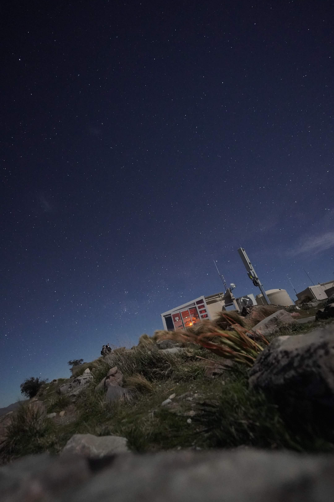
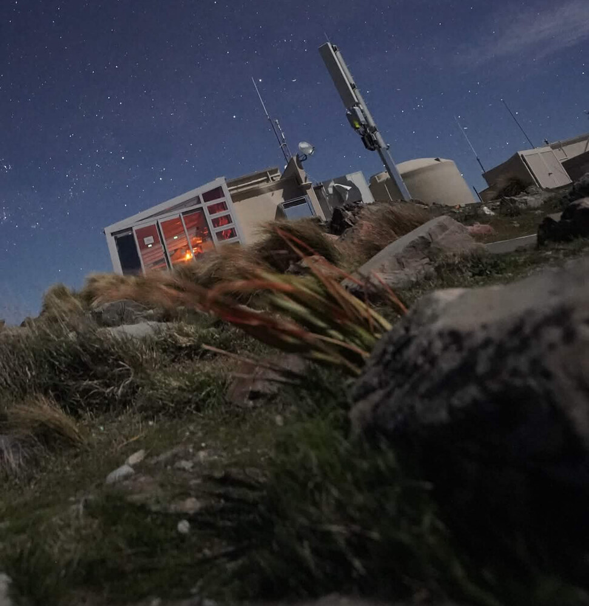
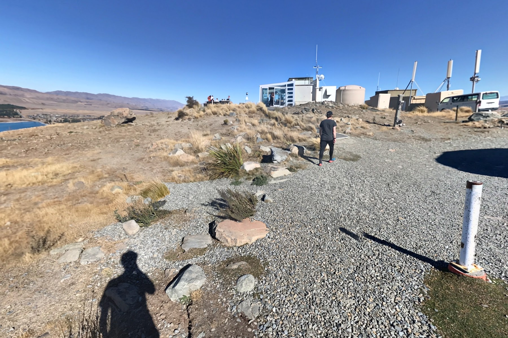

# HITCON — will-be-there-osint

**Thể loại:** Misc / OSINT, xác định địa điểm từ ảnh và tìm Plus Code.

**Flag đã được người giải xác nhận đúng khi submit:**

```text
hitcon{4V8G2F78+X4}
```

Ảnh được đối chiếu với khu Astro Café tại University of Canterbury Mt John Observatory, gần Lake Tekapo, New Zealand. Bước quyết định là khoanh các ô Plus Code quanh điểm panorama rồi thử các ứng viên. Tên địa danh và tọa độ panorama giúp tìm đúng khu vực, nhưng chưa đủ để chọn ngay ô đáp án.

## 1. Đề bài và dữ liệu đầu vào

Đề cung cấp ảnh `IMG_1812.jpg` cùng yêu cầu:

> Submit the location's full Plus Code in uppercase.
> Flag format: hitcon{XXXXXXXX+XX}



Thông tin của file gốc:

| Thuộc tính | Giá trị |
| --- | --- |
| Định dạng | JPEG |
| Kích thước | 2160 × 3240 pixel |
| Dung lượng | 1.164.861 byte |
| GPS trong metadata | Không tìm thấy |
| SHA-256 | `98ae81c0851d3bf2979a618fe308df44c9c203dcd1c1a0860024b980a37974cb` |

Kiểm tra bằng:

```bash
exiftool -G1 -s assets/IMG_1812.jpg
sha256sum assets/IMG_1812.jpg
```

ExifTool chỉ hiển thị thông tin JPEG/JFIF, kích thước ảnh và các thuộc tính file; không có tọa độ GPS hay thời điểm chụp trong EXIF để sử dụng trực tiếp. Thời gian sửa file trên filesystem không được coi là thời gian chụp.

## 2. Đối chiếu công trình và cảnh vật

Phần hữu ích nhất của ảnh nằm ở công trình và tiền cảnh phía dưới. Những chi tiết dùng để đối chiếu gồm:

- Mặt kính của tòa nhà được chia thành các ô chữ nhật, có một dải ô nhỏ ở bên phải.
- Hình dạng mái và phần tường đặc sát mặt kính.
- Bồn nước hình trụ màu sáng ở bên phải tòa nhà.
- Các cột và thiết bị quanh công trình.
- Địa hình đồi đá, các bụi cỏ lá dài và mép đường đi.



Sau khi khoanh khu Astro Café / Mt John Observatory, các panorama do người giải cung cấp cho phép đối chiếu trực tiếp bố cục công trình, bồn nước và địa hình. Ảnh ban ngày dưới đây là một khung nhìn từ panorama thứ ba:



[Mở panorama tham chiếu trên Google Maps](https://www.google.com/maps/place/43%C2%B059%2708.3%22S+170%C2%B027%2753.9%22E/@-43.9853387,170.4650508,3a,48.9y,144.18h,80.27t/data=!3m11!1e1!3m9!1sCIHM0ogKEICAgICKoYCI2QE!2e10!3e11!6shttps:%2F%2Flh3.googleusercontent.com%2Fgpms-cs-s%2FAM4Q-U_6GVWkMQWOIoWkIASi6Pch2e4IaR-qNYpN7gleRp_V0gBNhBEWqOpPHXrh2hChmN7MAMlSVv_i0SBxHpUtFHYwHqKBW5-etjyQ3G68YHuAUleJXnh_GJCtneTku6LIwNNScpV87w%3Dw900-h600-k-no-pi9.726449200182628-ya166.1827839024054-ro0-fo100!7i8704!8i4352!9m2!1b1!2i17!4m4!3m3!8m2!3d-43.98563!4d170.46498).

Các chi tiết kiến trúc hỗ trợ xác định đúng cụm công trình. Việc khớp chính xác một viên đá hay vị trí đặt máy ảnh vẫn còn bất định, do góc nhìn, độ cao máy ảnh và thời điểm chụp khác nhau. Vì vậy, bước tiếp theo là khoanh một vùng nhỏ thay vì khẳng định một tọa độ duy nhất từ tiền cảnh.

### Xem panorama ở độ phân giải đầy đủ

Trong URL được cung cấp có các thành phần:

```text
!1sCIHM0ogKEICAgICKoYCI2QE
!7i8704!8i4352
```

ID panorama là `CIHM0ogKEICAgICKoYCI2QE`; kích thước ảnh được ghi trong link là 8704 × 4352. Link cũng chứa một URL ảnh `lh3.googleusercontent.com` với tham số tạo khung nhìn thu nhỏ.

Với chính ảnh này, thay phần tham số kích thước/khung nhìn bằng `=s0` trả về ảnh panorama đầy đủ. Kích thước file tải xuống đã được kiểm tra là **8704 × 4352 pixel**, 8.944.683 byte. Đây là thao tác đã kiểm chứng với URL của bài này, không phải giả định rằng mọi ảnh Google Maps đều có cùng cách tải.

- [Ảnh panorama đầy đủ đã lưu](assets/panorama3-full-8704x4352.jpg).
- [URL nguồn của panorama đầy đủ](https://lh3.googleusercontent.com/gpms-cs-s/AM4Q-U_6GVWkMQWOIoWkIASi6Pch2e4IaR-qNYpN7gleRp_V0gBNhBEWqOpPHXrh2hChmN7MAMlSVv_i0SBxHpUtFHYwHqKBW5-etjyQ3G68YHuAUleJXnh_GJCtneTku6LIwNNScpV87w=s0).

Ảnh đầy đủ có dạng panorama trải phẳng. Khi xem bằng trình xem 360°, có thể xoay để quan sát các hướng và phóng to chi tiết trong giới hạn độ phân giải nguồn.

## 3. Đọc đúng tọa độ trong link Google Maps

Link tham chiếu có hai cặp tọa độ đáng chú ý:

```text
/@-43.9853387,170.4650508,3a,48.9y,144.18h,80.27t/
...
!3d-43.98563!4d170.46498
```

Trong link này:

| Thành phần | Ý nghĩa sử dụng trong quá trình giải |
| --- | --- |
| `@-43.9853387,170.4650508` | Tọa độ gắn với điểm panorama, dùng làm tâm khoanh vùng |
| `144.18h` | Hướng nhìn của khung panorama trong link |
| `!3d-43.98563!4d170.46498` | Tọa độ địa điểm/ghim của trang Maps đang mở |

Tọa độ gắn với panorama cũng không tự chứng minh vị trí máy ảnh của ảnh đề. Nó là một điểm tham chiếu gần khu vực cần tìm.

Ba panorama đã được xem trong quá trình giải cho các kết quả mã hóa sau:

| Điểm tham chiếu | Vĩ độ | Kinh độ | Full Plus Code |
| --- | --- | --- | --- |
| Panorama 1 | -43.9853715 | 170.4651196 | `4V8G2F78+V2` |
| Panorama 2 | -43.9854345 | 170.4651574 | `4V8G2F78+R3` |
| Panorama 3, dùng làm tâm | -43.9853387 | 170.4650508 | `4V8G2F78+V2` |
| Ghim địa điểm ở cuối link | -43.9856300 | 170.4649800 | `4V8G2F77+PX` |

Đổi tọa độ panorama thứ ba sang Plus Code cho ra `4V8G2F78+V2`. Mã này đã không giải quyết được bài; cần xét các ô lân cận.

## 4. Vì sao cần khoanh theo ô Plus Code?

Định dạng yêu cầu gồm **10 ký tự mã**, với dấu `+` chèn sau ký tự thứ tám:

```text
4V8G2F78+X4
```

Chỉ phần Plus Code bên trong ngoặc nhọn viết hoa; tiền tố flag giữ nguyên `hitcon`.

Ở độ dài này, Plus Code dùng 5 cặp ký tự, lần lượt biểu diễn vĩ độ và kinh độ. Bảng chữ số cơ số 20 là:

```text
23456789CFGHJMPQRVWX
```

Độ phân giải của từng cặp:

| Cặp ký tự | Kích thước theo mỗi trục, tính bằng độ |
| --- | --- |
| 1 | 20 |
| 2 | 1 |
| 3 | 0.05 |
| 4 | 0.0025 |
| 5 | 0.000125 |

Mỗi mã đầy đủ theo định dạng bài tương ứng một **ô 0.000125° × 0.000125°**. Ở vĩ độ gần 44° Nam, kích thước thực tế xấp xỉ **13,9 m theo bắc–nam và 10,0 m theo đông–tây**.

Ô chứa panorama thứ ba, `4V8G2F78+V2`, có ranh giới:

```text
Vĩ độ:  [-43.985375, -43.985250)
Kinh độ: [170.465000, 170.465125)
```

Các khoảng lấy đầu dưới và không lấy đầu trên. Một vị trí chỉ cách vài mét có thể sang mã khác nếu ở gần ranh giới ô. Điều này giải thích vì sao tìm đúng địa danh hoặc dùng ngay tọa độ một panorama vẫn có thể trả về flag sai.

## 5. Khoanh vùng và liệt kê ứng viên

Người giải nhận định vị trí cần tìm nằm gần cụm đá và bụi cỏ, về phía trái khung nhìn tham chiếu. Nếu dùng hướng `144.18°` trong link làm chuẩn, hướng lệch trái 90° là:

```text
144.18° - 90° = 54.18°
```

Đó là hướng đông bắc. Thông tin này được dùng để ưu tiên các ô phía đông và phía bắc. Đây là cách xếp thứ tự thử; bản thân hướng nhìn không xác định được khoảng cách tới viên đá hoặc tọa độ chính xác của nó.

Từ ô `4V8G2F78+V2`, lấy thêm hai ô mỗi phía, tạo lưới **5 × 5 = 25 ô**. Vùng này rộng khoảng **50 m theo đông–tây và 70 m theo bắc–nam**:

```text
Vĩ độ:  [-43.985625, -43.985000)
Kinh độ: [170.464750, 170.465375)
```

Lưới dưới đây có phía bắc ở trên và phía đông ở bên phải. Ô đáp án được in đậm:

| Tây ← | | | | → Đông |
| --- | --- | --- | --- | --- |
| `4V8G2F77+XW` | `4V8G2F77+XX` | `4V8G2F78+X2` | `4V8G2F78+X3` | **`4V8G2F78+X4`** |
| `4V8G2F77+WW` | `4V8G2F77+WX` | `4V8G2F78+W2` | `4V8G2F78+W3` | `4V8G2F78+W4` |
| `4V8G2F77+VW` | `4V8G2F77+VX` | `4V8G2F78+V2` | `4V8G2F78+V3` | `4V8G2F78+V4` |
| `4V8G2F77+RW` | `4V8G2F77+RX` | `4V8G2F78+R2` | `4V8G2F78+R3` | `4V8G2F78+R4` |
| `4V8G2F77+QW` | `4V8G2F77+QX` | `4V8G2F78+Q2` | `4V8G2F78+Q3` | `4V8G2F78+Q4` |

Ba mã `4V8G2F78+V2`, `4V8G2F78+R2` và `4V8G2F78+R3` đã được loại khỏi danh sách gửi ở vòng thử này theo quá trình thử trước đó. Còn lại **22 ứng viên**, được lưu nguyên thứ tự trong [candidate-flags.txt](candidate-flags.txt).

Cách tạo lưới là dịch tọa độ tâm ô theo bội của `0.000125°`, rồi mã hóa lại toàn bộ tọa độ. Làm như vậy xử lý được cả trường hợp vượt ranh giới làm thay đổi tiền tố: hai cột bên trái thuộc `4V8G2F77`, trong khi ba cột còn lại thuộc `4V8G2F78`.

Ứng viên được xác nhận đúng là dòng **16** của danh sách:

```text
hitcon{4V8G2F78+X4}
```

Kết quả cuối dựa trên thông báo submit thành công của người giải. Danh sách được sinh cục bộ; script đính kèm chỉ thực hiện tính toán tọa độ và xuất các ứng viên.

## 6. Giải mã ô đáp án và đặt ghim kiểm tra

Với `4V8G2F78+X4`, lấy chỉ số ký tự trong bảng cơ số 20, tính từ 0:

| Cặp | Chỉ số vĩ độ | Chỉ số kinh độ | Độ phân giải |
| --- | --- | --- | --- |
| `4V` | 2 | 17 | 20 |
| `8G` | 6 | 10 | 1 |
| `2F` | 0 | 9 | 0.05 |
| `78` | 5 | 6 | 0.0025 |
| `X4` | 19 | 2 | 0.000125 |

Bắt đầu từ vĩ độ -90° và kinh độ -180°, tọa độ góc tây nam của ô là:

```text
lat = -90 + 2×20 + 6×1 + 0×0.05 + 5×0.0025 + 19×0.000125
    = -43.985125

lon = -180 + 17×20 + 10×1 + 9×0.05 + 6×0.0025 + 2×0.000125
    = 170.465250
```

Từ đó có các ranh giới và tâm ô:

| Thuộc tính | Giá trị |
| --- | --- |
| Biên nam | -43.985125 |
| Biên bắc | -43.985000 |
| Biên tây | 170.465250 |
| Biên đông | 170.465375 |
| Tâm ô | **-43.9850625, 170.4653125** |

[Mở tâm ô đáp án trên Google Maps](https://www.google.com/maps?q=-43.9850625,170.4653125).

Tâm ô này cách tọa độ panorama thứ ba khoảng **30,7 m về phía bắc**, **20,9 m về phía đông**, tương đương khoảng **37,2 m** theo đường thẳng. Nó nằm ở góc đông bắc của lưới đã tạo.

Tọa độ tâm được tính từ mã đã xác nhận để tiện đặt ghim. Kết quả submit xác nhận ô Plus Code, chưa đủ để kết luận máy ảnh nằm chính xác tại tâm ô hoặc một viên đá cụ thể.

## 7. Tái hiện bằng script

File [solve.py](solve.py) chỉ sử dụng thư viện chuẩn Python, không cần cài thêm gói. Phần mã hóa dùng `Decimal` để tránh sai lệch do số thực nhị phân ở ranh giới ô. Script hỗ trợ đúng dạng mã đầy đủ 10 ký tự mà bài yêu cầu.

Chạy trong thư mục này:

```bash
# Mã hóa tọa độ panorama làm điểm tham chiếu.
python solve.py --encode -43.9853387 170.4650508

# In đủ lưới 5 × 5, hàng phía bắc trước.
python solve.py --grid

# Tái tạo 22 flag theo đúng thứ tự danh sách đã gửi.
python solve.py > candidates-reproduced.txt

# Giải mã và kiểm tra ô đáp án.
python solve.py --inspect 4V8G2F78+X4
```

Lệnh đầu trả về:

```text
4V8G2F78+V2
```

Lệnh cuối trả về:

```text
Code: 4V8G2F78+X4
South: -43.985125
North: -43.985000
West: 170.465250
East: 170.465375
Center: -43.9850625, 170.4653125
Offset from panorama: north 30.7 m, east 20.9 m
Approximate distance: 37.2 m
Google Maps: https://www.google.com/maps?q=-43.9850625,170.4653125
Flag: hitcon{4V8G2F78+X4}
```

Thứ tự ưu tiên trong script được giữ lại từ quá trình khoanh vùng thủ công. Script không có chức năng tự nhận diện vị trí từ ảnh. Khi hoàn thiện write-up, đã kiểm tra danh sách sinh lại trùng đủ 22 mã với file lưu, lưới có 25 ô khác nhau, và mã hóa lại tâm cũng như các điểm sát biên cho kết quả phù hợp.

## 8. Những điểm cần chú ý khi giải dạng bài này

- Địa danh là bước khoanh vùng ban đầu; đáp án Plus Code có thể nằm trong một ô nhỏ gần đó.
- Một link Maps có thể chứa cả tọa độ panorama và tọa độ ghim địa điểm. Cần xác định đúng cặp tọa độ đang dùng làm tham chiếu.
- “Bên trái ảnh” phụ thuộc hướng nhìn. Chỉ dẫn này hỗ trợ chọn vùng, chưa cho biết khoảng cách hay tọa độ của vật thể.
- Khi đã khoanh được khu vực vài chục mét, liệt kê các ô lân cận giúp xử lý sai số vị trí. Nên tạo các ô từ tọa độ để xử lý đúng việc đổi tiền tố mã.
- Ảnh đối chiếu, tọa độ suy ra và kết quả submit là những loại bằng chứng khác nhau. Ở bài này, ảnh giúp thu hẹp vùng, còn kết quả submit chốt mã `4V8G2F78+X4`.

## Các file kèm theo

```text
osint/
├── README.md                         # Write-up
├── solve.py                          # Mã hóa, giải mã, sinh lưới và ứng viên
├── candidate-flags.txt                # 22 ứng viên theo thứ tự ban đầu
└── assets/
    ├── IMG_1812.jpg                  # Bản sao nguyên vẹn của ảnh đề
    ├── building-detail.jpg           # Vùng công trình được cắt ra để đối chiếu
    ├── panorama3-reference.jpg       # Khung nhìn tham chiếu ban ngày
    └── panorama3-full-8704x4352.jpg   # Panorama đầy đủ tải từ URL nguồn
```
