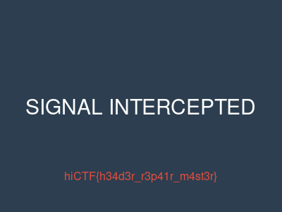

# Broken Signals

**Thể loại:** Forensics (sửa tệp)  **Flag:** `hiCTF{h34d3r_r3p41r_m4st3r}`

> Nhóm tình báo tín hiệu của chúng tôi chặn được một tệp trong lần rà soát thường kỳ, nhưng tệp có vẻ đã bị hỏng. Không ứng dụng thông thường nào mở được nó. Bản thân tệp có vấn đề — bạn có thể sửa nó và khôi phục thông điệp ẩn không?

Tệp: `broken-signals.zip` → `broken_signal.dat` (15.916 byte)

## Lời giải

1. `xxd broken_signal.dat | head -1` cho thấy:

   ```
   00 00 00 00 0d 0a 1a 0a 00 00 00 0d 49 48 44 52 ...
   ```

   Các byte 4–7 (`0D 0A 1A 0A`) cùng chunk `IHDR` ngay sau đó cho thấy đây là tệp PNG. Chỉ bốn byte đầu của chữ ký tám byte đã bị ghi thành số không. Giá trị đúng là `89 50 4E 47` (`\x89PNG`).
2. Ghi lại `89 50 4E 47` vào các byte 0–3.
3. Kiểm tra xem còn phần nào khác bị hỏng không:
   - CRC của mọi chunk đều hợp lệ (`IHDR`, `cHRM`, `bKGD`, `tIME`, 3 chunk `tEXt`, `IDAT`, `IEND`).
   - IHDR ghi kích thước 400×300, RGBA 16 bit, nên dữ liệu ảnh phải có `300 × (1 + 400×8) = 960.300` byte. IDAT giải nén ra đúng kích thước đó.
4. Mở ảnh đã sửa. Ảnh hiện dòng **SIGNAL INTERCEPTED**, với flag màu đỏ ngay bên dưới.



## Các tệp

- `solve/repair.py` sửa chữ ký PNG, kiểm tra CRC của từng chunk và kích thước IDAT, rồi ghi ảnh PNG đã sửa.
- `artifacts/fixed.png` là ảnh đã sửa có chứa flag.
- `artifacts/broken_signal_original.dat` là tệp hỏng ban đầu.
- `artifacts/solver_output.txt` là kết quả kiểm tra chunk và CRC.
