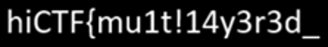
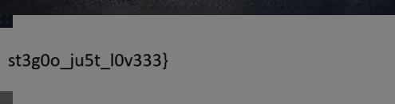

# Echoes of a Forgotten Canvas

**Thể loại:** Giấu tin nhiều lớp  **Flag:** `hiCTF{mu1t!14y3r3d_st3g0o_ju5t_l0v333}`

> Một tệp trông có vẻ bình thường vừa xuất hiện, nhưng để lại dấu vết khác thường. Thoạt nhìn nó có vẻ hoàn chỉnh, song vẻ ngoài có thể đánh lừa. Hãy xem xét kỹ artifact và tìm ra thứ bị bỏ lại.

Tệp: `echoes-of-a-forgotten-canvas.zip` → `chall.png` (8,9 MB)

## Lời giải: bốn lớp

### Lớp 1: Mẹo chiều cao PNG → nửa đầu flag

- PIL không mở được `chall.png`, và CRC của IHDR không khớp với header (`ee7fe302` được tính so với `4675412a` được lưu).
- IHDR khai báo **4000×4000**. Thử các giá trị chiều cao cho đến khi CRC khớp thì được **4500**. Dữ liệu IDAT cũng giải nén ra đúng 4500 hàng RGBA, xác nhận kết quả đó.
- Khi khôi phục chiều cao thật, một dải 500 hàng xuất hiện ở cuối ảnh. Nó trông đen trong RGB, nhưng **kênh alpha** vẽ ra văn bản:

  

  → `hiCTF{mu1t!14y3r3d_`

### Lớp 2: ZIP được mã hóa nối sau IEND

- Sau chunk `IEND` có một tệp **ZipCrypto** dài khoảng 3,3 MB, chứa `carrier.jpg`.
- Tìm được mật khẩu bằng John the Ripper:

  ```
  zip2john appended.zip > h.txt
  john --wordlist=/usr/share/wordlists/rockyou.txt h.txt     →  dreamcatcher
  ```

### Lớp 3: Steghide trong carrier.jpg

- `carrier.jpg` là ảnh một bài thơ tên "WILDER ECHOES". Các từ trong thơ gợi ý mật khẩu ở từng lớp (giấc mơ → *dreamcatcher*, *profound*, rồi cuối cùng → *finall.jpg*).
- Steghide cho biết ảnh có dung lượng giấu tin, nhưng mật khẩu rỗng không dùng được. `stegseek` tìm bằng rockyou và cho ra kết quả ngay:

  ```
  stegseek carrier.jpg /usr/share/wordlists/rockyou.txt   →  "profound"  → finall.jpg
  ```

### Lớp 4: Mẹo chiều cao JPEG → nửa sau flag

- `finall.jpg` (ảnh một con hẻm ở Trogir, Croatia) không có dữ liệu nối đuôi, EXIF hay dữ liệu steghide; jsteg/F5/outguess cũng không tìm thấy gì.
- libjpeg cảnh báo: **"3379 extraneous bytes before marker 0xd9"**. Dữ liệu quét chứa nhiều hàng MCU hơn chiều cao khai báo trong header.
- Marker SOF0 ghi 495×**647**. Sửa chiều cao thành giá trị lớn hơn (1300) rồi giải mã lại sẽ hiện các hàng ẩn phía dưới:

  

  → `st3g0o_ju5t_l0v333}`

**Flag:** `hiCTF{mu1t!14y3r3d_` + `st3g0o_ju5t_l0v333}`

## Các tệp

- `solve/solve.py` tái hiện cả chuỗi bằng các mật khẩu đã khôi phục (các lệnh tìm mật khẩu được liệt kê ở trên).
- `artifacts/chall_fixed_height.png` là PNG có chiều cao thật 4500.
- `artifacts/flag_part1_alpha.png` là chữ ở kênh alpha (nửa đầu).
- `artifacts/appended.zip` là tệp ZipCrypto được tách từ sau IEND.
- `artifacts/carrier.jpg` là ảnh bài thơ "WILDER ECHOES".
- `artifacts/finall.jpg` là dữ liệu trích từ steghide.
- `artifacts/finall_tall.jpg` và `finall_revealed.png` là JPEG đã sửa chiều cao và ảnh sau khi hiện đầy đủ.
- `artifacts/flag_part2_hidden_rows.png` là các hàng bị ẩn (nửa sau).
